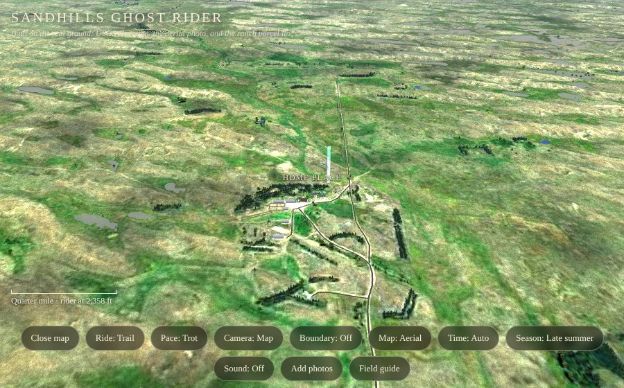
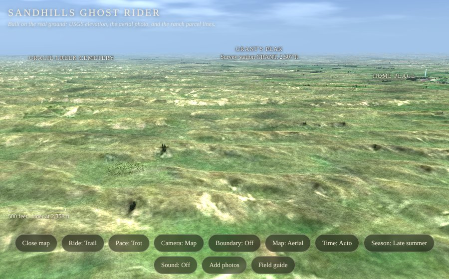
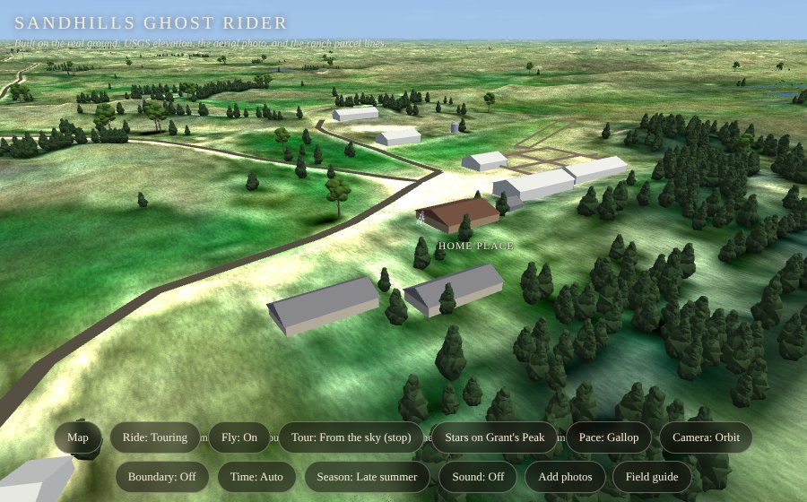

# Sandhills Ghost Rider

A ghost horse and rider on the real ground of Gracie Creek Ranch, near Burwell in the Nebraska Sandhills, where I grew up. I no longer have any connection to the ranch. This is a way to go back.

It is built from two things: my own photographs of the ranch, and public government data. The government data gives the true shape of the land, the wetlands, the water and the trees. My photographs give it its look: the grass and sky colors were measured month by month from about a thousand of my landscape photos taken there, and the scene is tuned to match them.



## The idea

Many people lose a place that shaped them: a family farm that was sold, a childhood home, a landscape changed by fire, flood or development. Photos keep pieces of it. This project asks what it could mean to walk back into the whole place, at its real scale, under its real sky, built from your own pictures of it. It is meant as a way to revisit and remember a place you will not see again.

## What is in it

- **Real ground.** USGS 3DEP lidar elevation at about 5 m over the core of the ranch and 20 m beyond, true scale with no vertical exaggeration.
- **The aerial view.** USDA NAIP imagery at about 4 m draped over the ground.
- **Wetlands and water.** All 14,636 mapped USFWS National Wetlands Inventory areas: wet meadows, marshes, ponds, lakes and river channels, each water body at a level taken from the elevation data.
- **Trees.** About 13,600 trees found in the aerial photo: eastern redcedar windbreaks, and cottonwoods on wet ground.
- **Grass.** Little bluestem, sand bluestem, prairie sandreed and the rest, changing with the seasons, plus sedges and cattails in the marshes.
- **The rider.** A ghost horse that walks, trots and gallops (rigged horse model by Quaternius, CC0), and a rider who moves with it.
- **Flight and tours.** The rider can fly, and there are guided tours on the ground or from the sky.
- **The real sky.** About 2,300 stars and the Moon and planets placed where they are over the ranch tonight, and a stop on Grant's Peak to watch them.
- **Memories.** Photographs fade in and out as you ride past. This public version carries only a few of mine.
- **More.** A red-tailed hawk, a drive up Gracie Creek Avenue from Highway 96, parcel boundaries from the county records, and an overhead map that clicks in and out.

| | |
|---|---|
|  |  |
|  |  |

## Run it

The page loads its ground data from the files beside it, so it needs to be served over http rather than opened as a file.

```powershell
cd SandhillsGhostRider
python -m http.server 8080
# then open http://localhost:8080 in Chrome
```

Or turn on GitHub Pages for this repository.

A desktop graphics card is recommended. A phone version is planned.

## Controls

| | |
|---|---|
| A / D or arrow keys | Steer |
| W / S | Pace: stand, walk, trot, gallop |
| F | Fly or land; Q climbs, Z drops |
| M | Map. Double-click the map to ride or fly there |
| Drag | Look around (rider's eye) or orbit the camera |
| Buttons | Camera views, tours, stars on Grant's Peak, time of day, season, sound, photos |

## Data sources

All public data, used as published:

- USGS 3D Elevation Program (3DEP), elevation
- USDA National Agriculture Imagery Program (NAIP), aerial imagery via The National Map
- US Fish and Wildlife Service National Wetlands Inventory
- USGS National Hydrography Dataset and US Topo
- NOAA National Geodetic Survey, survey marks (station GRANT)
- Bureau of Land Management PLSS, and Loup County parcel lines (boundaries only)
- OpenStreetMap contributors, roads (ODbL)
- Star catalog from d3-celestial (Olaf Frohn, BSD), planet positions from the JPL approximate orbital elements
- three.js (MIT), Quaternius animal models (CC0)

`src/` holds the scripts that prepared the fine ground, wetlands, water levels and tree positions.

## Photos

The few photographs embedded as memories are my own, from the ranch, and are not licensed for reuse. You can add your own with the Add photos button.
