# Sandhills Ghost Rider

A ghost horse and rider on the real ground of Gracie Creek Ranch, near Burwell in the Nebraska Sandhills, where I grew up. I no longer have any connection to the ranch. This is a way to go back.

It is built from two things: my own photographs of the ranch, and public government data. The government data gives the true shape of the land, the wetlands, the water and the trees. My photographs give it its look: the grass and sky colors were measured month by month from about a thousand of my landscape photos taken there, and the scene is tuned to match them.

**Ride it in your browser:** https://robotwhitebread.github.io/SandhillsGhostRider/ (a desktop or laptop works best)

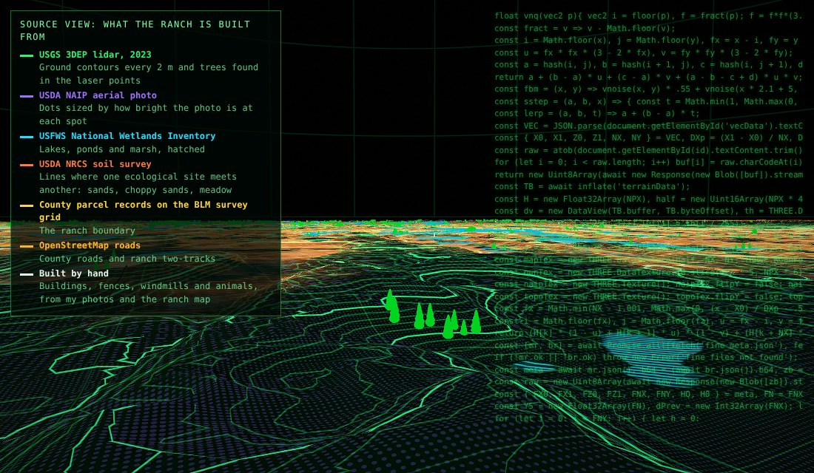

*Source view: the same hills drawn as lines, one color per data source, with the page's own code scrolling past. Press **View: Scene** in the button bar to switch.*

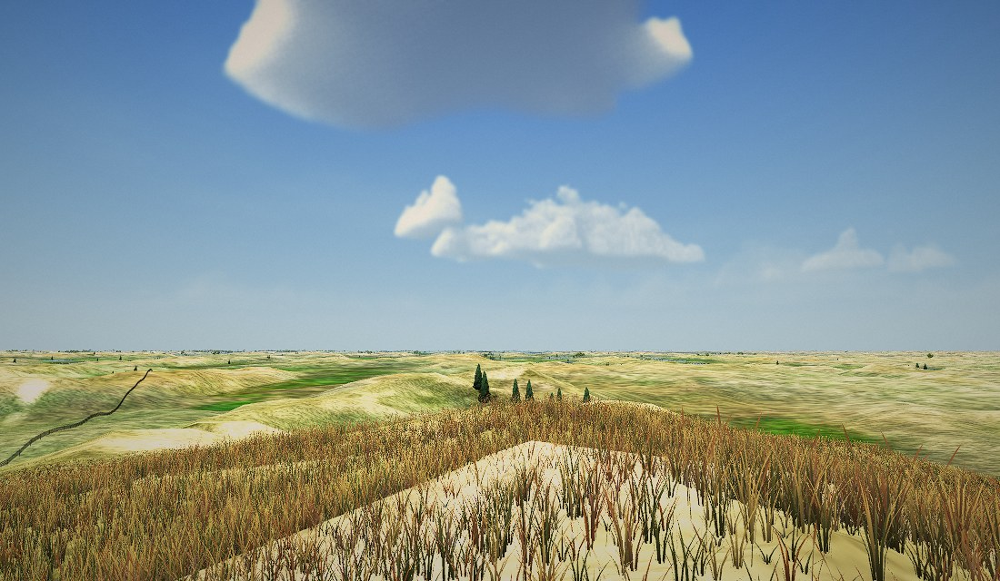

## What I built, at a glance

| | |
|---|---|
| 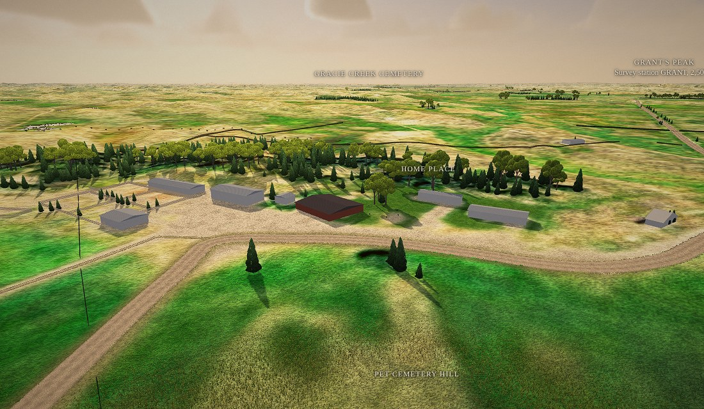 | 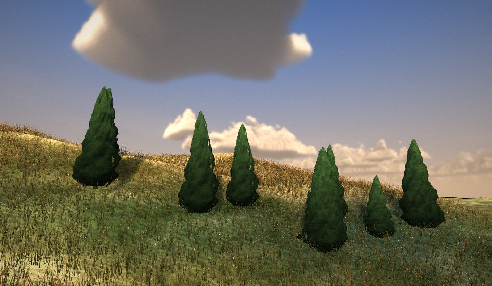 |
| The home place: gravel yard, lawn by the houses, windbreaks | Eastern redcedars on a grass slope |
| 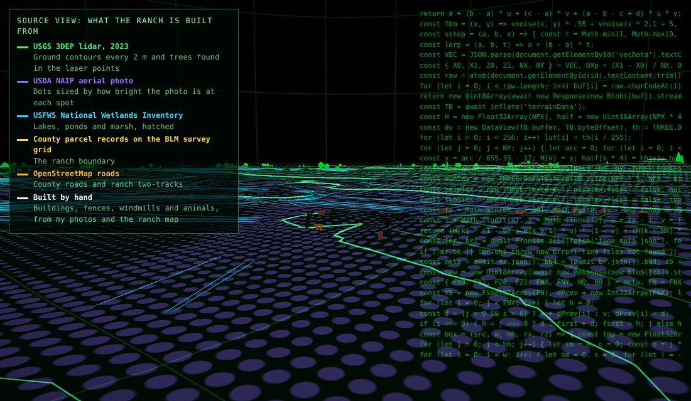 |  |
| Source view at Nichol Lake | Source view from Grant's Peak |
| 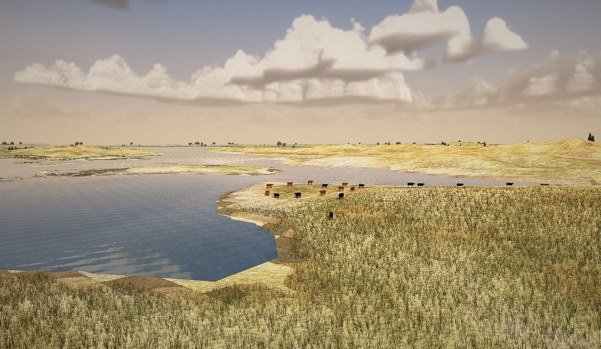 |  |
| Cattle along Nichol Lake | Cumulus with real volume |

- A real place at true scale: about 60 square miles of Sandhills from government elevation data, with the lakes, marshes, roads and trees where they really are.
- A living prairie: grasses that change by season, wind, weather, cattle, horses, birds on the ponds, windmills and stock tanks, fences and cattle guards.
- A real sky: volumetric clouds, sun and shadows through the day, and the true stars, Moon and planets over the ranch at night.
- One web page, no install. It was built with AI support and checked against my own photos and memory of the place.

## Source view

Press **View: Scene** in the button bar to switch to Source view. The scene drops to black and each data source is drawn as lines in its own color, while the page's own code scrolls past on the right. You can keep riding and flying in this view.

| Color | Source | What it draws |
|---|---|---|
| Green | USGS 3DEP lidar | Ground contours every 2 m, and the trees |
| Violet | USDA NAIP aerial photo | Dots sized by how bright the photo is at each spot |
| Cyan | USFWS National Wetlands Inventory | Lakes, ponds and marsh |
| Orange | USDA NRCS soil survey | Lines where one ecological site meets another |
| Yellow | County parcel lines on the BLM survey grid | The ranch boundary |
| Amber | OpenStreetMap roads | County roads and two-tracks |
| White | Built by hand | Buildings, fences, windmills and animals |

## The idea

Many people lose a place that shaped them: a family farm that was sold, a childhood home, a landscape changed by fire, flood or development. Photos keep pieces of it. This project asks what it could mean to walk back into the whole place, at its real scale, under its real sky, built from your own pictures of it. It is meant as a way to revisit and remember a place you will not see again.

## What is in it

- **Real ground.** USGS 3DEP lidar elevation at about 5 m over the core of the ranch and 20 m beyond, true scale with no vertical exaggeration.
- **The aerial view.** USDA NAIP imagery at about 4 m draped over the ground.
- **Wetlands and water.** All 14,636 mapped USFWS National Wetlands Inventory areas: wet meadows, marshes, ponds, lakes and river channels, each water body at a level taken from the elevation data.
- **Soils.** The USDA NRCS soil survey of Loup County decides what grows where: thin, tawny cover and blowouts on the Choppy Sands, thick green grass and sedges on the Subirrigated meadows. Inside the fences the ground is about 51% Sands, 17% Choppy Sands and 32% meadow, lowland and wetland sites.
- **Trees.** About 13,600 trees found in the aerial photo: eastern redcedar windbreaks, and cottonwoods on wet ground.
- **Grass.** Little bluestem, sand bluestem, prairie sandreed and the rest, changing with the seasons, plus sedges and cattails in the marshes.
- **The rider.** A ghost horse that walks, trots and gallops (rigged horse model by Quaternius, CC0), and a rider who moves with it.
- **Flight and tours.** The rider can fly, and there are guided tours on the ground or from the sky.
- **The real sky.** About 2,300 stars and the Moon and planets placed where they are over the ranch tonight, and a stop on Grant's Peak to watch them.
- **Memories.** Photographs fade in and out as you ride past. This public version carries only a few of mine.
- **Clouds and light.** Cumulus with real volume that cast moving shadows, lakes that mirror the sky, light shafts at low sun.
- **Ranch life.** Cattle along Nichol Lake, horses near the home place, windmills and stock tanks, barbed wire fences, gravel roads with cattle guards, and ducks and shorebirds that flush when the rider comes close.
- **Homesteaders.** The people who first patented this ground, from the BLM General Land Office records.
- **More.** A red-tailed hawk, a drive up Gracie Creek Avenue from Highway 96, parcel boundaries from the county records, and an overhead map that clicks in and out.

| | |
|---|---|
|  | 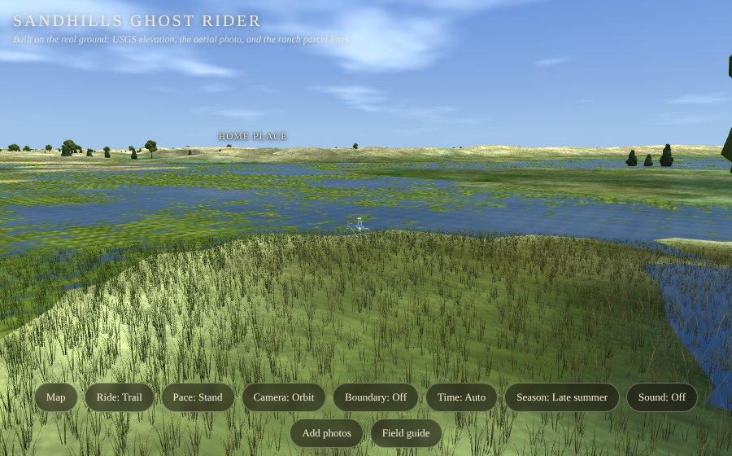 |
|  | 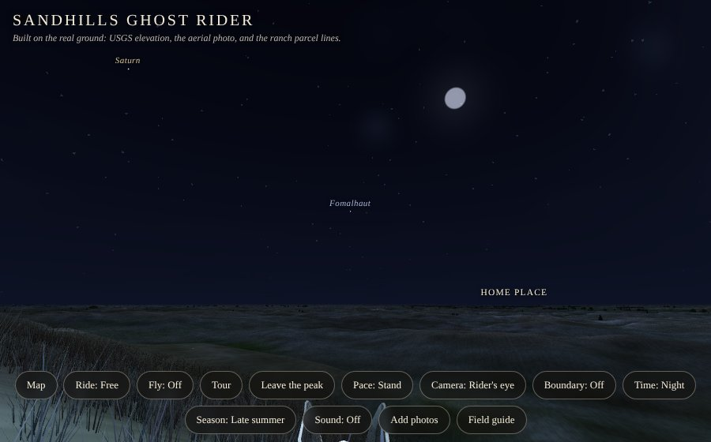 |

## Seeing the ghost

| | |
|---|---|
| 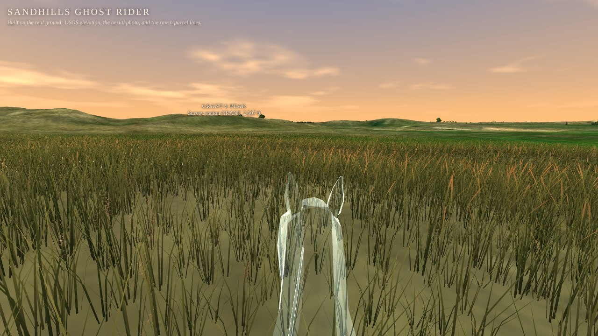 | 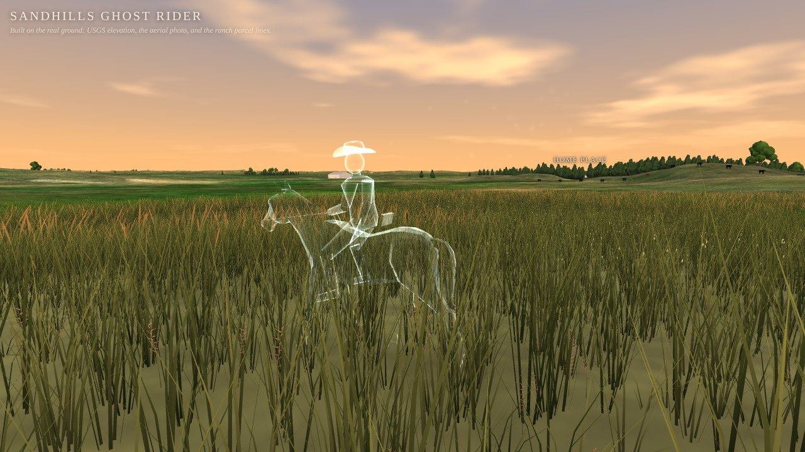 |
| Rider's eye view, looking over the horse's head | The ghost rider up close |
| 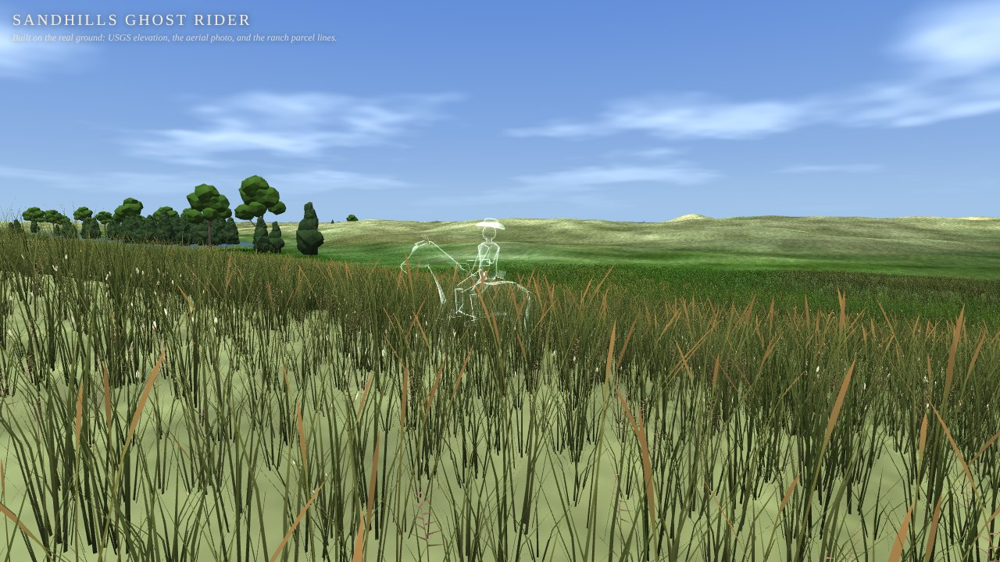 | 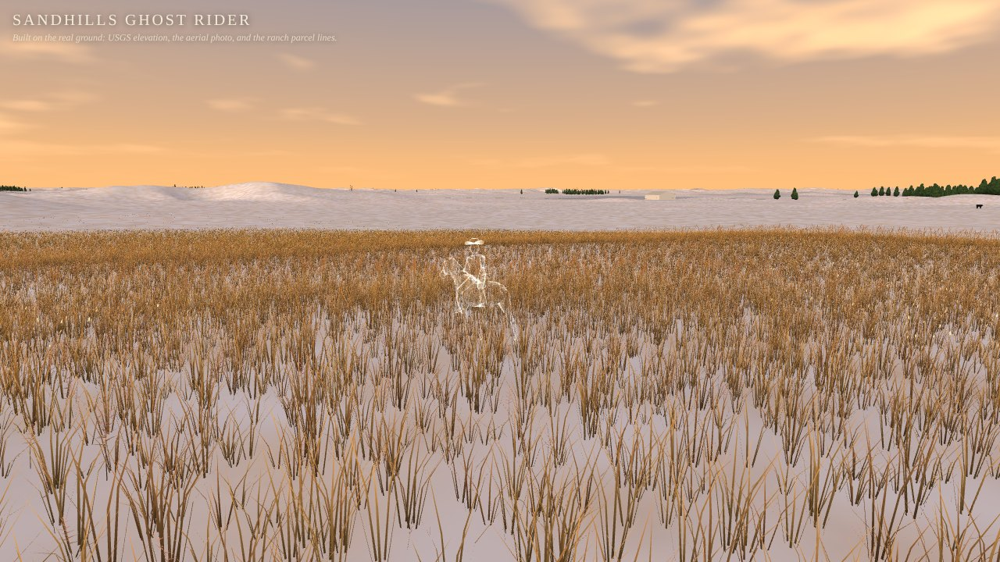 |
| Spring gallop through the hills | Winter |
| 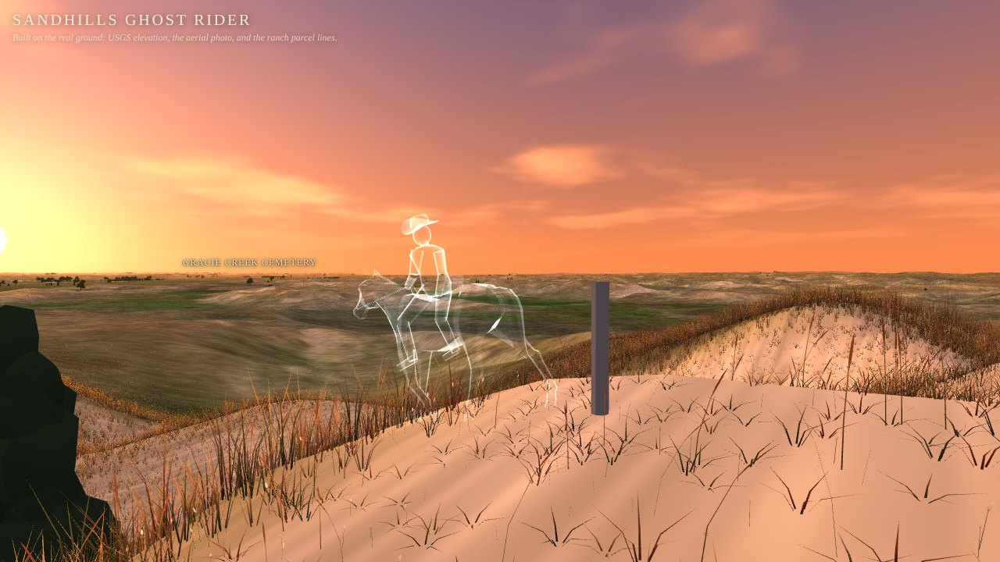 | 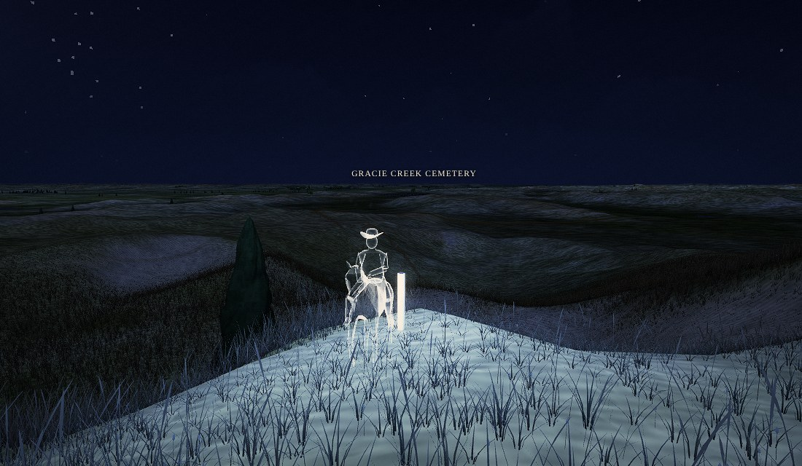 |
| Sunset on Grant's Peak | Stargazing on Grant's Peak, with the real sky for the date |
| 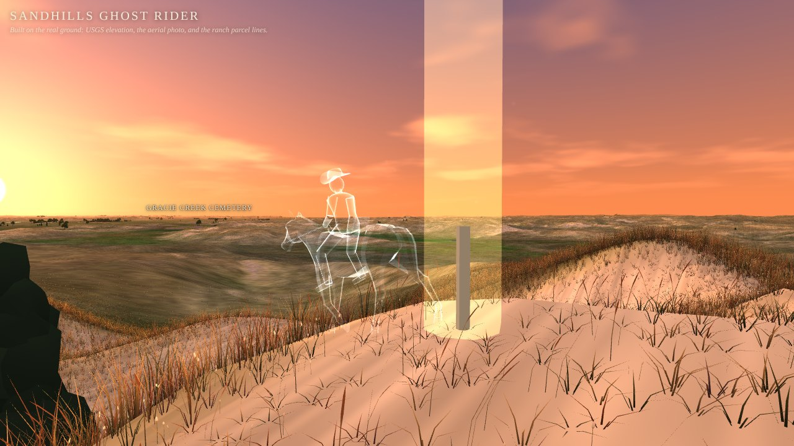 | 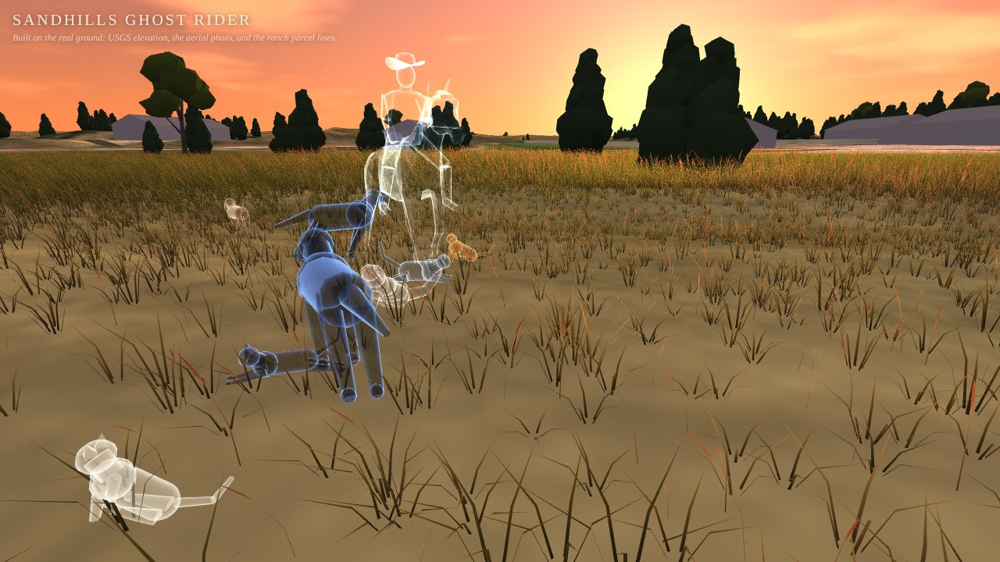 |
| Late sun on the peak | Pet Cemetery Hill: the labs come to meet the rider |
| 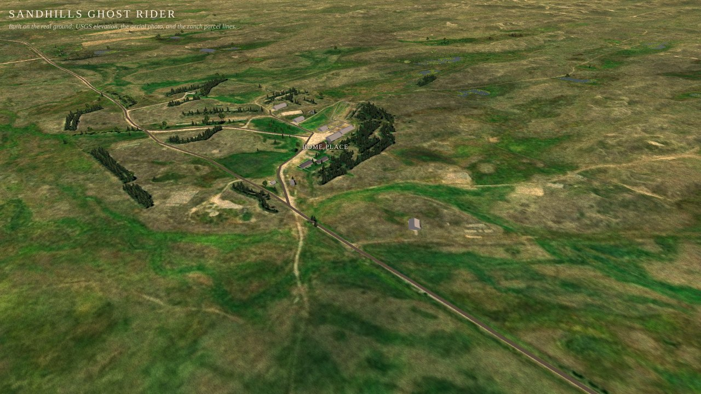 |  |
| Bird's eye view over the home place | The real night sky from the peak, with the Moon and planets where they are tonight |

## Pet Cemetery Hill

Just southeast of the home place is the hill where the ranch dogs and cats were laid to rest. Their ghosts are there: two black labs, four beagles, two German Shorthaired Pointers and five cats. The beagles run ghost rabbits, the pointers work and point a sharp-tailed grouse until it flushes, and the cats lounge in the short grass. Ride up and the labs come running, then sit, prance and spin at the rider's feet. They will follow you a little way, but they stay near the hill.

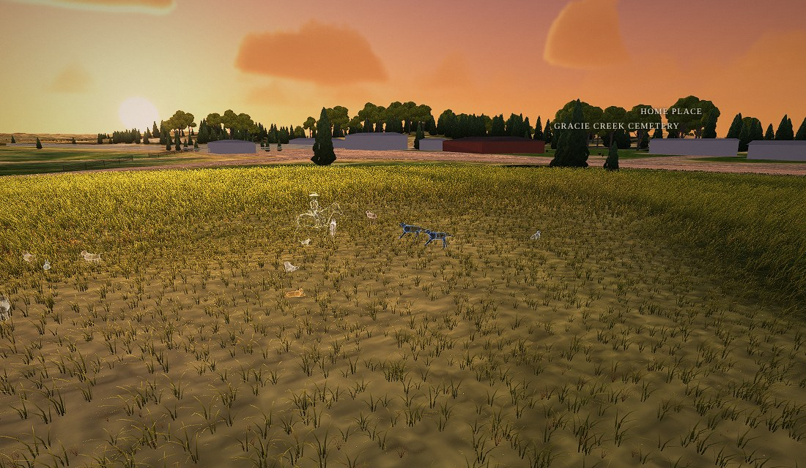

## What it is built on

The ground is not invented. These images come straight from the public data used to build it.

| | |
|---|---|
| 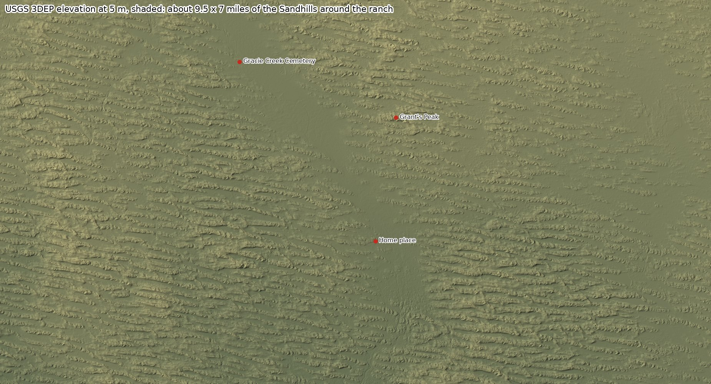 | 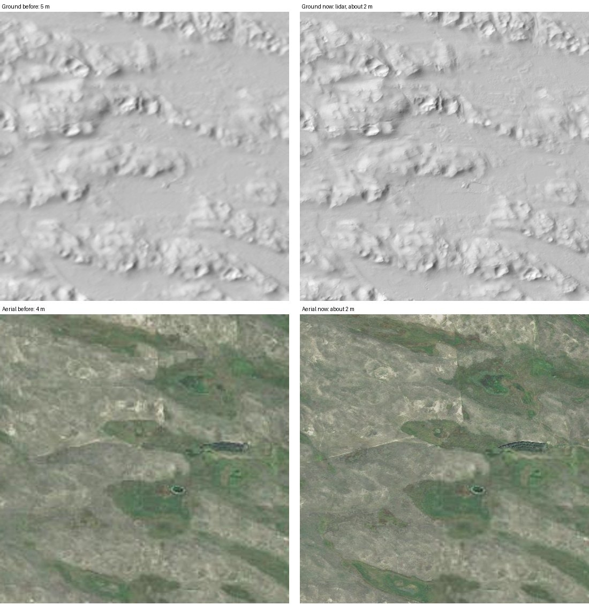 |
| USGS 3DEP elevation, shaded | 1 m lidar detail near the home place compared with the 5 m ground |
| 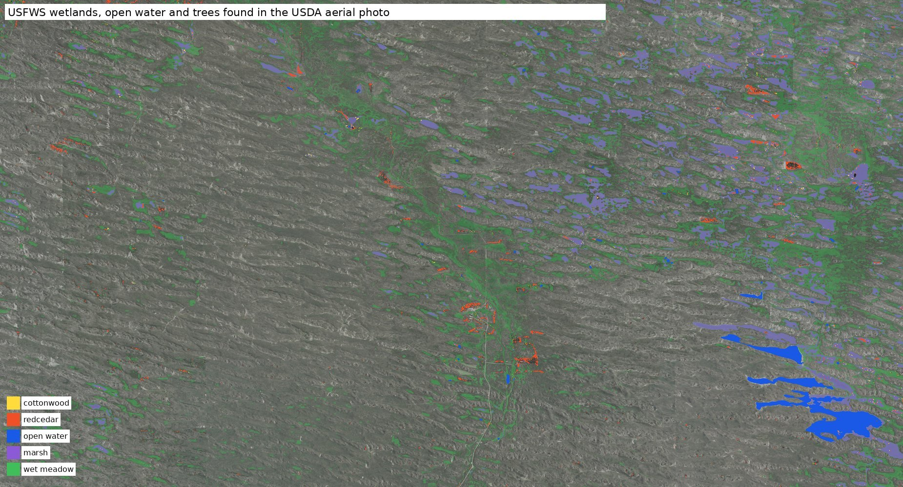 | 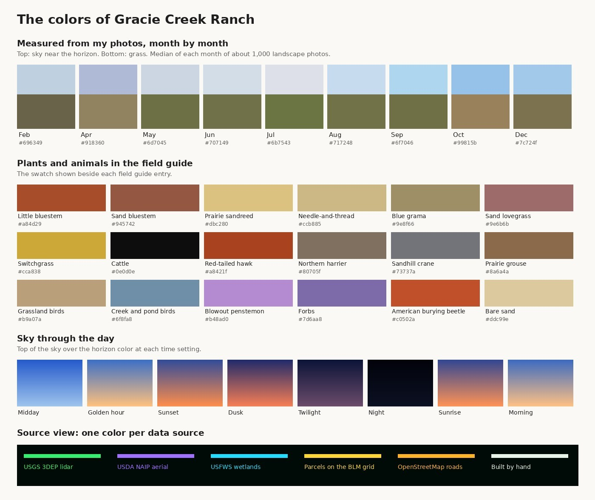 |
| National Wetlands Inventory plus trees found in the NAIP aerial | The palette: colors measured from my photos by month, the field guide, the sky through the day, and the Source view |

## Run it

The page loads its ground data from the files beside it, so it needs to be served over http rather than opened as a file.

```powershell
cd SandhillsGhostRider
python -m http.server 8080
# then open http://localhost:8080 in Chrome
```

Or turn on GitHub Pages for this repository.

A desktop graphics card is recommended. A phone version is planned.

## Controls

| | |
|---|---|
| A / D or arrow keys | Steer |
| W / S | Pace: stand, walk, trot, gallop |
| F | Fly or land; Q climbs, Z drops |
| M | Map. Double-click the map to ride or fly there |
| Drag | Look around (rider's eye) or orbit the camera |
| Buttons | Camera views, tours, stars on Grant's Peak, time of day, season, sound, photos |

## Data sources

All public data, used as published:

- USGS 3D Elevation Program (3DEP), elevation
- USDA National Agriculture Imagery Program (NAIP), aerial imagery via The National Map
- US Fish and Wildlife Service National Wetlands Inventory
- USDA Natural Resources Conservation Service, Soil Survey Geographic Database (SSURGO), Loup County, Nebraska
- USGS National Hydrography Dataset and US Topo
- NOAA National Geodetic Survey, survey marks (station GRANT)
- Bureau of Land Management PLSS, and Loup County parcel lines (boundaries only)
- Bureau of Land Management General Land Office Records, original land patents
- OpenStreetMap contributors, roads (ODbL)
- Star catalog from d3-celestial (Olaf Frohn, BSD), planet positions from the JPL approximate orbital elements
- three.js (MIT), Quaternius animal models (CC0)

`src/` holds the scripts that prepared the fine ground, wetlands, water levels and tree positions.

## License

- **Code:** MIT. Use it to build a place of your own.
- **Photographs:** my own, all rights reserved. You can add yours with the Add photos button.
- **Data:** U.S. federal data is public domain; roads are from OpenStreetMap (ODbL); the horse model is CC0; the star catalog is BSD.

See [LICENSE](LICENSE) for the full terms.

## Passing On the Place

A companion page: a plain guide to farm and ranch estate planning, written for the people on an operation who usually get left out of the planning. It covers the basics, why good plans do not get made, the family side that is not about paperwork, a ten step roadmap of documents to ask to see, and where to get help.

Read it: https://robotwhitebread.github.io/SandhillsGhostRider/passing-on-the-place.html

It is general information, not legal, tax or financial advice.

## Live version

https://robotwhitebread.github.io/SandhillsGhostRider/
